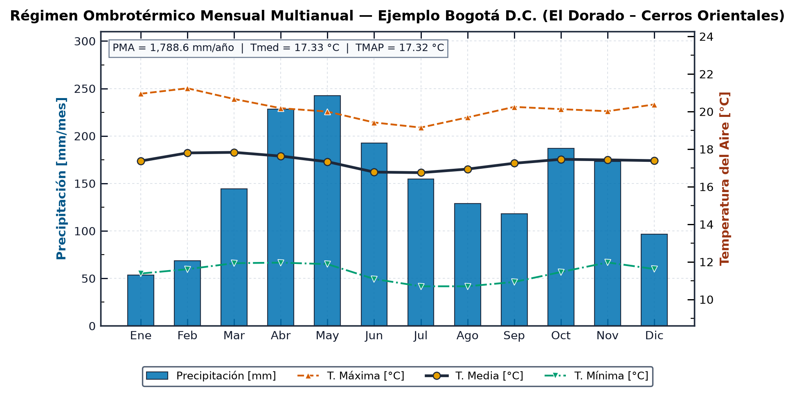
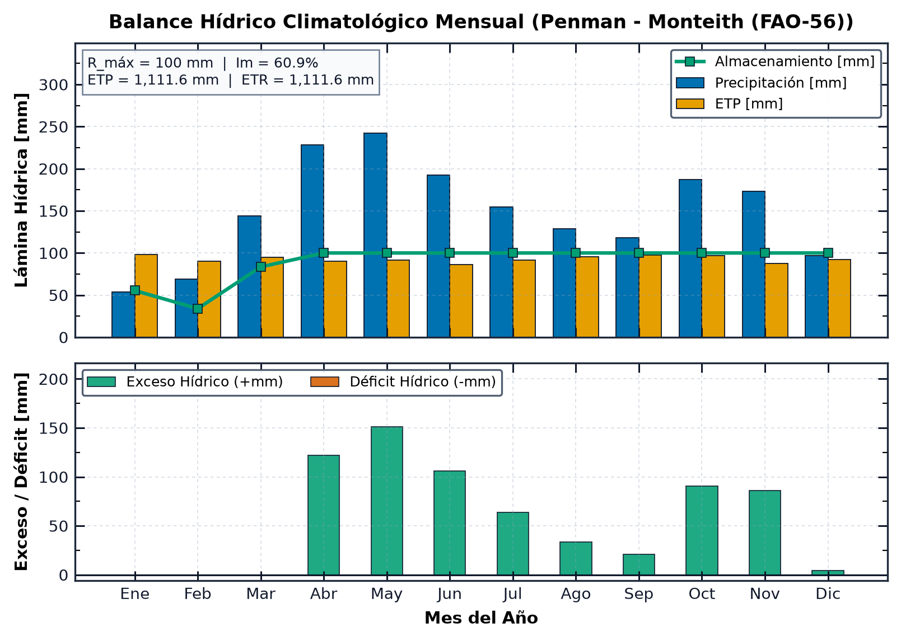
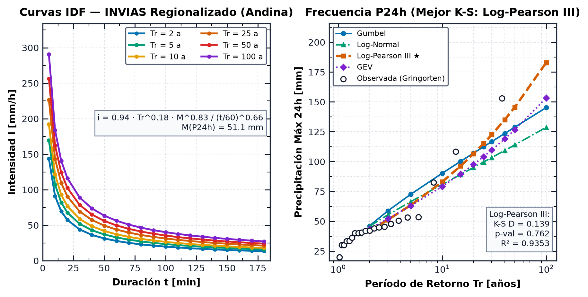
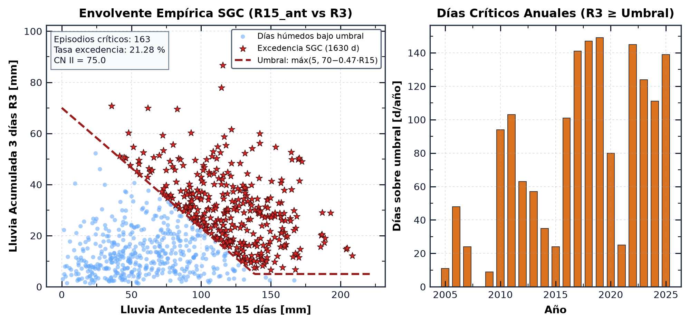
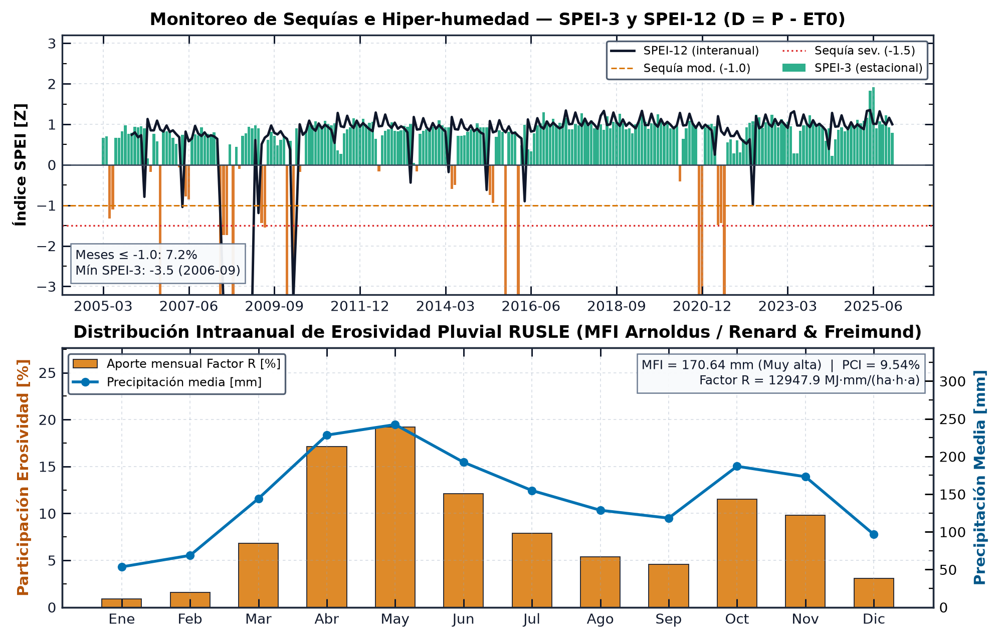
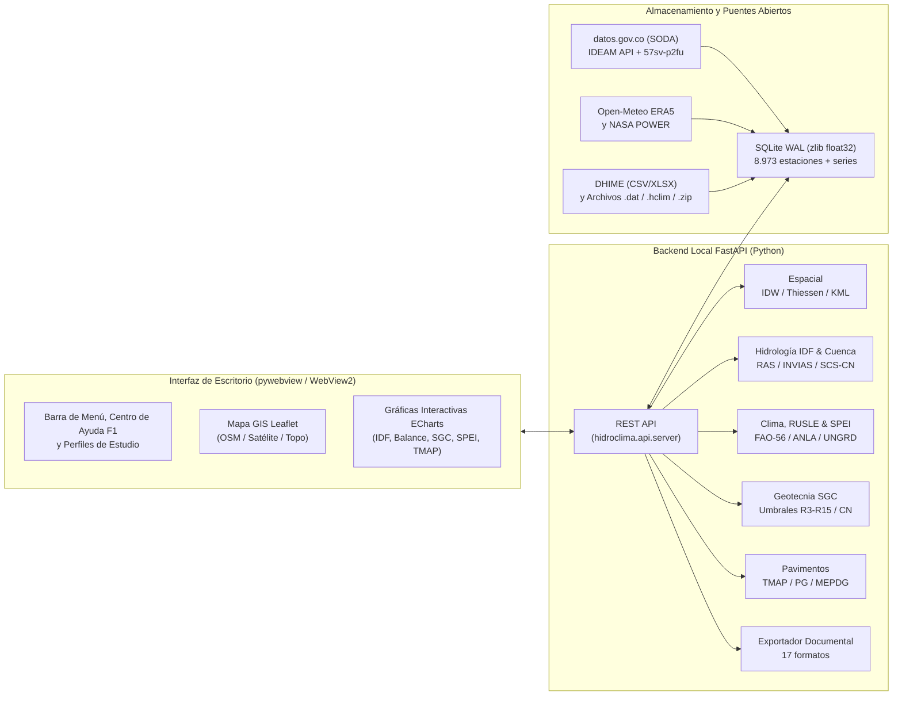

<div align="center">

<picture>
  <source media="(prefers-color-scheme: dark)" srcset="docs/assets/logo_lockup_dark.png">
  
</picture>

**Suite de escritorio para análisis hidrometeorológico, curvas IDF, balance hídrico climatológico, geotecnia de lluvias detonantes, erosividad RUSLE e ingeniería de pavimentos.**

[](CHANGELOG.md)
[](pyproject.toml)
[](installer/setup.iss)
[](docs/manuals/01_Manual_Informacion_General.pdf)
[](LICENSE)

[Instalación en Windows](#instalación-en-windows) · [Capacidades](#capacidades-de-ingeniería-y-normativa) · [Galería Técnica (Bogotá D.C.)](#galería-técnica--caso-de-referencia-bogotá-dc) · [Manuales PDF](#documentación-oficial-pdf) · [Compilación](#ejecución-desde-código-fuente-y-compilación)

</div>

---

`HidroClima Studio` es una aplicación gratuita de código abierto desarrollada para consultoría e ingeniería civil en Colombia y regiones tropicales. Integra el catálogo nacional de **8.973 estaciones**, puentes directos hacia repositorios científicos abiertos, ponderación espacial sobre corredores KML/KMZ, modelado climático e hidrológico normativo y generación automatizada de memorias técnicas e insumos para diseño estructural y drenaje.

---

## Instalación en Windows

### Opción A — Instalador Clásico de Windows (`Setup.exe` — Recomendado)

1. Descarga **`HidroClimaStudio-Setup-1.0.0.exe`** desde la sección [Releases](https://github.com/pperillav/HidroClima-Studio/releases).
2. Ejecuta el asistente: permite instalación por usuario (`%LOCALAPPDATA%\Programs\HidroClima Studio`) sin exigir privilegios administrativos o para todo el equipo, crea accesos directos en **Menú Inicio** y **Escritorio**, e incluye desinstalador estándar de Windows.
3. Tus bases de datos de estaciones y proyectos se almacenan en `%LOCALAPPDATA%\HidroClimaStudio\data\hidroclima.db`, separadas de los binarios del programa para conservar tus series históricas en futuras actualizaciones.

### Opción B — Paquete Portable (`.zip`)

1. Descarga y descomprime **`HidroClimaStudio-1.0.0-Windows-Portable.zip`**.
2. Ejecuta **`HidroClimaStudio.exe`**. La base de datos se crea localmente en la subcarpeta `data/` junto al ejecutable.

---

## Capacidades de Ingeniería y Normativa

| Dominio | Metodologías, Modelos y Normas Implementadas | Aplicación Principal |
| :--- | :--- | :--- |
| **Geoespacial y Red de Estaciones** | Catálogo precargado de **8.973 estaciones** (33 departamentos, 1.121 municipios), mapa **Leaflet** multi-capa (OSM, Satélite ESRI, Topográfico), trazado en pantalla e importación de corredores **KML / KMZ / GeoJSON**, ponderación **IDW**, **Thiessen** o manual. | Selección de estaciones representativas por cuenca o eje de proyecto. |
| **Hidrología de Extremos y Cuenca INVIAS** | Frecuencia de $P_{24h}$ (**Gumbel**, **Log-Normal**, **Log-Pearson III**, **GEV** + K-S y $R^2$); **4 métodos IDF** (**INVIAS Regionalizado**, **Silva**, **Sherman**, **Bell**); **Bloques Alternos**; tabla **RAS Res. 0330/2017** e **INVIAS Drenaje**; **Cuenca (`Kirpich`, `Témez`, `Racional`, `SCS-CN`)**; **SPI-3 / SPI-12**. | Diseño hidráulico, drenaje vial, alcantarillado pluvial, box-culverts y puentes. |
| **Geotecnia SGC (Movimientos en Masa)** | Lluvias antecedentes móviles (`R1`, `R3`, `R7`, `R15`, `R30`, `R90`), envolvente empírica detonante ($R_3 \ge \max(5, a - b \cdot R_{15,\text{ant}})$), detección histórica de episodios críticos e infiltración diaria **SCS (`CN I/II/III`)**. | Estudios geotécnicos **SGC**, evaluación de amenaza por remoción en masa y estabilidad de laderas. |
| **Climatología, Erosividad y Sequías (ANLA)** | $ET_0$ **Penman-Monteith FAO-56** y **Thornthwaite (1948)**; balance hídrico cíclico; **Caldas-Lang**, **Holdridge**, **Köppen-Geiger**, **ENA-IDEAM**; **Erosividad RUSLE** (`FI`, `MFI`, `PCI`, **Factor R**); **SPEI-3 / SPEI-12** y **IAP (%) IDEAM**. | Estudios de Impacto Ambiental (**EIA / ANLA**), **POMCA**, degradación de suelos y gestión del riesgo (**UNGRD**). |
| **Calidad, Homogeneidad y Tendencias** | Matriz de completitud año × variable, alertas de rango físico, prueba de homogeneidad de **Pettitt (1979)**, tendencia **Mann-Kendall** / pendiente de **Theil-Sen** e índices extremos **ETCCDI / OMM** (`Rx1day`, `Rx5day`, `CDD`, `CWD`, `R10mm`, `R20mm`, `R50mm`, `SU25`, `SU32`, `TXx`, `TNn`). | Control de calidad de series diarias y variabilidad climática. |
| **Ingeniería de Pavimentos** | **TMAP / w-MAAT** (Carta W de **Shell** año a año y ciclo climatológico), zonificación climática **INVIAS `R1`–`R6`**, temperatura máxima de **7 días consecutivos**, grado asfáltico **Superpave PG** (98 % LTPP a 20 mm) y archivos **MEPDG**. | Diseño de pavimentos flexibles y rígidos, selección de ligantes asfálticos y modelación AASHTOWare. |

---

## Galería Técnica — Caso de Referencia: Bogotá D.C.

El proyecto incluido [`Ejemplo_Bogota.hclim`](data/sample_projects/Ejemplo_Bogota.hclim) analiza series reales (2005–2025) de las estaciones **21205791 (`ELDORADO CATAM - AUT`, 2.548 m)** y **21205580 (`VENADO ORO VIVERO`, 2.725 m)** sobre los Cerros Orientales y la Sabana de Bogotá. Todas las figuras son generadas directamente a **240 DPI** por el motor de exportación del software:

<table>
  <tr>
    <td width="50%" align="center">
      
      <br/><sub><b>Climograma Mensual Multianual</b> — Régimen bimodal sabanero, T<sub>max</sub>, T<sub>min</sub> y ETP FAO-56</sub>
    </td>
    <td width="50%" align="center">
      
      <br/><sub><b>Balance Hídrico Climatológico Cíclico</b> — Evolución mensual de almacenamiento, déficits y excesos</sub>
    </td>
  </tr>
  <tr>
    <td width="50%" align="center">
      
      <br/><sub><b>Curvas IDF y Frecuencia P24h</b> — Familias Tr = 2 a 100 años y ajuste empírico de Gringorten</sub>
    </td>
    <td width="50%" align="center">
      
      <br/><sub><b>Geotecnia SGC (R3 vs R15_ant)</b> — Envolvente crítica de lluvias detonantes e historial anual</sub>
    </td>
  </tr>
  <tr>
    <td colspan="2" align="center">
      
      <br/><sub><b>Sequías Hidroclimáticas (SPEI-3 / SPEI-12) y Erosividad Pluvial RUSLE</b> — Evaluación integrada para EIA (ANLA)</sub>
    </td>
  </tr>
</table>

---

## Arquitectura del Sistema



---

## Fuentes de Datos Abiertas y Formatos de Exportación

### Prioridad de Consolidación por Fuente

1. **`Manual` (Editor Matriz 12 × 31):** edición directa y corrección supervisada en la interfaz de escritorio.
2. **`IDEAM-DHIME` (`.csv` / `.xlsx`):** ingestión automática de descargas tabulares oficiales del portal DHIME.
3. **`IDEAM-API` (`www.datos.gov.co`):** consulta vía SoQL del catálogo nacional (`hp9r-jxuu`), flujo unificado en tiempo real (`57sv-p2fu`) y conjuntos por variable, con detección automática de estaciones automáticas cercanas (`- AUT`).
4. **`Archivo-Histórico` y Proyectos `.hclim`:** lectura multihilo de paquetes `.zip`, `.rar`, carpetas `SHC/*.dat` y archivos `.hclim` (con compatibilidad de lectura `.cli`).
5. **`NASA POWER` y `Open-Meteo ERA5`:** repositorios científicos abiertos sin credenciales comerciales para actualización hasta el día presente y complementación de radiación solar, brillo solar, humedad relativa y viento.

### 17 Formatos de Exportación Generados

- **Informes Documentales:** **PDF técnico multipágina** (240 DPI), **Word editable (`.docx`)**, **Libro Excel formulado (`.xlsx`)** de **10 hojas** con fórmulas vivas y 3 gráficos nativos, y **Reporte tabular (`.txt`)**.
- **Modelación Hidráulica, Pavimentos y SIG:** **Hietograma `.csv`** (EPA SWMM / HEC-HMS), **AASHTOWare MEPDG** (`.xml` `<ClimateObject>` y `_mepdg.txt`), capas **GeoJSON** y **KML**, archivo portable **`.hclim`**, y **7 gráficas científicas PNG (240 DPI)**.

---

## Documentación Oficial (PDF)

La suite incluye un libro documental compuesto por **4 manuales técnicos oficiales en PDF**, accesibles también desde el menú **Ayuda → Manuales Oficiales (F1)** dentro del programa:

| Manual | Contenido | Archivo |
| :--- | :--- | :--- |
| **01 · Información General** | Arquitectura del sistema, licencia abierta, fuentes públicas, requisitos e instalación. | [01_Manual_Informacion_General.pdf](docs/manuals/01_Manual_Informacion_General.pdf) |
| **02 · Tutorial y Casos Prácticos** | Guía paso a paso sobre el corredor **Bogotá D.C. (`21205791` + `21205580`)**, Thornthwaite mensual y puentes de datos. | [02_Manual_Tutorial.pdf](docs/manuals/02_Manual_Tutorial.pdf) |
| **03 · Manual Científico** | Formulación matemática completa: FAO-56, Shell `TMAP`, INVIAS, RAS 0330, SGC, RUSLE, SPEI y Pettitt. | [03_Manual_Cientifico.pdf](docs/manuals/03_Manual_Cientifico.pdf) |
| **04 · Referencia y Verificación** | Diccionario de funciones de interfaz, estructura de 10 hojas Excel formuladas y matriz de verificación numérica. | [04_Manual_Referencia_y_Verificacion.pdf](docs/manuals/04_Manual_Referencia_y_Verificacion.pdf) |

Documentación adicional en Markdown: [Metodología Técnica](docs/METODOLOGIA_TECNICA.md) · [Guía de Usuario](docs/GUIA_USUARIO.md) · [Registro de Cambios](CHANGELOG.md).

---

## Ejecución desde Código Fuente y Compilación

### 1. Entorno de Desarrollo y Pruebas

```bash
git clone https://github.com/pperillav/HidroClima-Studio.git
cd HidroClima-Studio
python -m venv .venv
.venv\Scripts\activate
pip install -e ".[dev]"
python run_hidroclima.py
```

Ejecutar la suite de pruebas automatizadas:

```bash
pytest -v
```

### 2. Compilar Ejecutable Portable e Instalador Windows (`Setup.exe`)

Requiere Python (`pip install -e ".[build]"`) e **Inno Setup 6**:

```bash
python build_installer.py
```

Genera en `dist/`:
- `dist/HidroClimaStudio/HidroClimaStudio.exe` y `dist/HidroClimaStudio-1.0.0-Windows-Portable.zip`
- `dist/HidroClimaStudio-Setup-1.0.0.exe` (instalador clásico de Windows)

Para generar únicamente el ejecutable portable `.zip`:

```bash
python build_portable.py
```

---

## Licencia

Software gratuito de código abierto distribuido bajo licencia **MIT**. Consulta [LICENSE](LICENSE) para más detalles.
